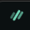

<div align="center">
  
  <h1>AuraBrowser</h1>
  <p><strong>A quiet, privacy-first browser that keeps your data on your machine.</strong></p>
  <p>
    <a href="https://f4209138-ctrl.github.io/Project-Aura/"><b>Website</b></a> ·
    <a href="https://github.com/f4209138-ctrl/Project-Aura/releases/latest/download/AuraBrowser-Setup.exe"><b>Download</b></a> ·
    <a href="#install">Install</a> ·
    <a href="#features">Features</a> ·
    <a href="#why-i-built-it">Why I built it</a> ·
    <a href="#feedback">Feedback</a>
  </p>
</div>

---

## What is AuraBrowser?

AuraBrowser is a desktop web browser built on Chromium (through Electron). It is designed around three ideas:

- **Your data stays with you.** No account, no sign-in, no cloud profile, no telemetry. Your profile, bookmarks and passwords live only on your computer.
- **You stay in control.** Search engine, look and feel, text size, page zoom, keyboard shortcuts, tab behaviour and privacy shields can all be changed from one settings page.
- **It stays out of your way.** A minimal interface with vertical tabs, split view and a one-click Tor mode built in.

> **Status:** early and experimental (v0.4.0). It works as a daily browser for many sites, but it is not yet a full replacement for Brave, Firefox or Chrome. See [Current limitations](#current-limitations).

## Why I built it

Most browsers ask you to trade something for convenience: an account, a sync service, usage data, or settings buried several menus deep. I wanted a browser where privacy is the default, every choice is easy to find and change, and nothing about me has to leave my computer.

AuraBrowser is my attempt at that. I'm building it in the open so people who care about the same things can try it, break it and help shape where it goes next.

## Why you should try it

- **No account, ever.** Install it and start browsing. Profiles are local only.
- **Privacy on by default.** Tracker blocking, HTTPS-only mode, pop-up blocking, tracking-parameter removal from links, and Do Not Track / Global Privacy Control headers.
- **Tor in one click.** Tor comes bundled with the browser. Turn it on to send your traffic through the Tor network with no extra setup.
- **Passwords that ask first.** Saved passwords are encrypted on your device and only shown after you verify it's you, every time.
- **Easy to move in.** A first-run setup page imports bookmarks, history, autofill data and settings from Chrome, Edge, Brave and Firefox.
- **Built to be shaped by you.** It's young, and feedback directly decides what gets built next.

## Features

**Browsing and tabs**
- Vertical tab sidebar that you can collapse
- Split view: drag a tab into the page to view two pages side by side
- Glance: preview a link in a temporary window without adding it to history
- Memory Saver puts inactive tabs to sleep (after 1, 5 or 15 minutes, or never)
- Session restore reopens your tabs after a restart. Restored tabs stay asleep until you click them, so startup is fast and light

**Privacy and security**
- Tracker and ad-domain blocking, HTTPS-only mode, pop-up blocking
- Strips `utm_*` and other tracking parameters from links
- Sites must ask before using your camera, microphone, location, notifications or clipboard. Your choices are remembered per site and can be changed in Settings
- Hardened app build: it can't be run as a plain Node.js program, ignores code-injection environment variables, and refuses to start if its app files were tampered with
- Chromium background services (component updates, reporting, link-tracking pings) are switched off
- Bundled Tor with a one-click toggle
- Encrypted local password vault, unlocked with **a passkey** (Windows Hello face/fingerprint/PIN, an Android or iPhone passkey, or a security key) **or a vault PIN** you choose. It locks again after one minute or when you leave the page.

**Your settings, your way**
- Search engine: Brave Search (default), DuckDuckGo, Google, Bing, Startpage or Ecosia
- Dark and light themes, interface text size, default page zoom
- Customisable keyboard shortcuts (see below)
- Profile name, language and country
- Choose your download folder

**Everyday tools**
- Find in page (`Ctrl+F`), zoom (`Ctrl +` / `Ctrl -`)
- Download manager with pause, resume, cancel and open
- Bookmarks
- Chromium Developer Tools

## Keyboard shortcuts

All of these can be changed in *Settings → Keyboard shortcuts*.

| Action | Default |
|---|---|
| New tab / close tab / reopen closed tab | `Ctrl+T` / `Ctrl+W` / `Ctrl+Shift+T` |
| Next / previous tab | `Ctrl+Tab` / `Ctrl+Shift+Tab` |
| Go to tab 1–8 / last tab | `Ctrl+1`–`Ctrl+8` / `Ctrl+9` |
| Address bar | `Ctrl+L` |
| Reload / reload without cache | `Ctrl+R` or `F5` / `Ctrl+Shift+R` |
| Back / forward | `Alt+←` / `Alt+→` |
| Find on page | `Ctrl+F` |
| Zoom in / out / reset | `Ctrl+=` / `Ctrl+-` / `Ctrl+0` |
| Full screen | `F11` |
| Split view / Glance | `Ctrl+Shift+S` / `Ctrl+Shift+G` |
| Settings / developer tools | `Ctrl+,` / `F12` |

## Install

**Windows (x64)**

1. Download **[AuraBrowser-Setup.exe](https://github.com/f4209138-ctrl/Project-Aura/releases/latest/download/AuraBrowser-Setup.exe)** (or from the [Releases](../../releases) page).
2. Run it and choose where to install. AuraBrowser installs for your user only, so no admin rights are needed. It adds Desktop and Start Menu shortcuts.
3. The first launch opens a one-time setup page to import your data and pick your settings.

To uninstall, use **Uninstall AuraBrowser** in the Start Menu, or go to *Settings → Apps*.

> The app isn't code-signed yet. Windows SmartScreen may show a warning the first time: choose **More info → Run anyway**.
> If **Smart App Control** is on, Windows blocks unsigned apps completely ("An Application Control policy has blocked this file"). A code-signed release is planned to fix this.

## Privacy, in plain words

- AuraBrowser sends **no analytics, usage data or crash reports**. There are no AuraBrowser servers.
- The search engine you choose receives your searches, and websites see normal browser traffic, unless Tor mode is on.
- Saved passwords are encrypted with your Windows account's protection and need your passkey or vault PIN to view. The passkey or PIN that unlocks the vault is separate from the passkeys you use to sign in to websites.
- If you import passwords from a CSV file, delete that file afterwards, because it is not encrypted.

## Current limitations

AuraBrowser is honest about what it isn't yet:

- Not every Brave feature is included. Brave-specific services (Rewards, Wallet, Sync, Brave News) can't be included.
- Chrome extension support, tab groups, workspaces/containers, built-in translation and casting are not built yet.
- Browser passwords and some cookies are encrypted by their original browser, so passwords must be imported via a CSV export.
- Because it is built on Electron, memory use is closer to Chrome than to Firefox. Reducing it is an ongoing goal.
- The installer is script-based and unsigned, so Windows Smart App Control blocks it.

## Run from source

Requires Node.js 22.12 or newer.

```powershell
npm install
node node_modules/electron/install.js   # downloads Electron if npm skipped its install script
npm start
```

Build a Windows package (downloads and verifies the Tor Expert Bundle):

```powershell
npm run package -- --dir
```

## Feedback

Found a bug, have an idea, or want a feature? I'd love to hear from you.

📧 **Email:** [13teamsaura@gmail.com](mailto:13teamsaura@gmail.com)

You can also open an issue on this repository. When reporting a bug, please include your Windows version, the AuraBrowser version (*Settings → About AuraBrowser*) and the steps that cause the problem.

---

<div align="center"><sub>Made with care for people who'd rather their browser didn't know everything about them.</sub></div>
